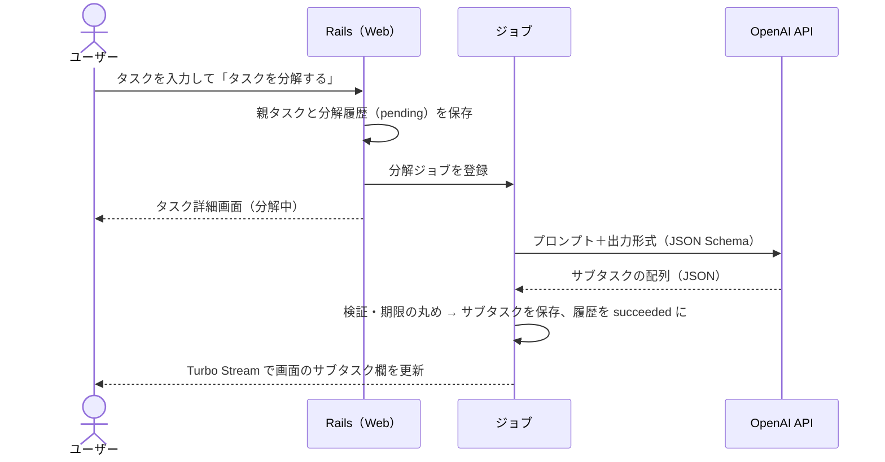

# AI タスク分解の設計

## 処理の流れ



- AI 呼び出しはリクエスト処理の中で行わず、**必ずジョブで非同期に実行**する（画面が固まらないように）
- 結果は Turbo Stream でリアルタイムに画面へ反映する（再読み込み不要）

## 構成

| 要素 | 配置（予定） | 役割 |
|---|---|---|
| LLM クライアント | `app/services/llm/` | AI API の呼び出しを隠す境界。本番用（OpenAI）とテスト用（固定応答）を環境変数 `LLM_CLIENT` で切り替える |
| 分解サービス | `app/services/task_decomposer.rb` | プロンプトの組み立て、応答の検証・整形、サブタスクの保存 |
| プロンプト | `app/services/task_decomposer/prompt.rb` | システムプロンプト・ユーザープロンプト・出力 JSON Schema |
| ジョブ | `app/jobs/decompose_task_job.rb` | 分解サービスの実行と画面更新の配信 |

## プロンプト設計

### システムプロンプトの要点
1. 役割: 社会人経験の長いベテラン社員として、新入社員のタスクを分解する
2. 各サブタスクは「〜する」で終わる、着手に迷わない具体的な行動にする
3. 他者の返答待ち・承認待ちが発生する工程（依頼・事前確認・承認）を見落とさず、早い順番に置き、`kind = special` にする
4. 不備があった場合の修正時間を見込む
5. 実行順に並べる
6. 親タスクに期限がある場合、現在日時から逆算して各サブタスクの期限を提案する（親の期限を超えない）
7. ペルソナの 3 事例（見積・起案書・経費申請）を**分解例（few-shot）**として含める

### ユーザープロンプトに渡す情報
- 現在日時（ISO 8601、Asia/Tokyo）
- 親タスクのタイトル・説明・期限
- 件数の指示（粒度により変える）

| 粒度 | 件数 |
|---|---|
| normal（既定・再分解） | 3〜8 件 |
| finer（もっと細かく） | 6〜12 件 |
| coarser（もっとざっくり） | 2〜4 件 |

### 出力形式（Structured Outputs, strict）

```json
{
  "subtasks": [
    {
      "title": "仕入れ先に見積もりを依頼する",
      "description": "15 時までに依頼し、当日中に回答をもらう",
      "kind": "special",
      "estimated_minutes": 15,
      "due_at": "2026-10-26T15:00:00+09:00"
    }
  ]
}
```

| フィールド | 型 | 必須 | 説明 |
|---|---|---|---|
| title | string | ○ | サブタスク名 |
| description | string \| null | ○ | 補足説明 |
| kind | `"basic"` \| `"special"` | ○ | 特殊タスク＝他者の対応待ちが発生する |
| estimated_minutes | integer \| null | ○ | 目安の所要時間（分） |
| due_at | string \| null | ○ | ISO 8601（タイムゾーン付き）。親に期限がなければ null |

## 応答の検証と整形

| ケース | 扱い |
|---|---|
| サブタスクが 0 件 | 失敗として扱う |
| 13 件以上 | 先頭 12 件のみ採用 |
| タイトルが空 | その要素を捨てる |
| タイトルが 200 文字超 | 200 文字に切り詰める |
| `due_at` が解釈できない | 期限なしとして保存 |
| `due_at` が親タスクの期限より後 | 親タスクの期限に丸める |

## 失敗時の挙動

| 失敗 | 対応 |
|---|---|
| タイムアウト（60 秒）・5xx・レート制限 | SDK で最大 2 回リトライ。それでも失敗したら分解履歴を `failed` にし、画面に「分解に失敗しました。再度お試しください」と再実行ボタンを出す |
| 応答が JSON として不正 | 同上 |
| API キー未設定 | 起動時ではなく分解実行時にエラーとし、履歴に記録 |

- 失敗しても既存のサブタスクは変更しない（保存はトランザクション内で行う）

## 再分解（拡張）
- 「未完了かつ AI が生成した」サブタスクだけを置き換える
- 手動で追加したサブタスク・完了済みのサブタスクは残す

## 設定（環境変数）

| 変数 | 既定値 | 説明 |
|---|---|---|
| `LLM_CLIENT` | API キーがあれば `openai`、なければ `fake` | `fake` は API キー不要の固定応答（開発・テスト用） |
| `OPENAI_API_KEY` | — | OpenAI の API キー。`.env` に置き、コミットしない |
| `OPENAI_MODEL` | `gpt-5-mini` | 使用モデル |

## 品質評価（AI 評価セット）

AI の出力は毎回変わるため、通常のテストとは別に**評価セット**で品質を確認する。

- 評価ケース: ペルソナの 3 事例（見積・起案書・経費申請）を固定入力として用意（`spec/evals/cases/*.yml`）
- 採点項目（ルールベース）
  - 件数が範囲内
  - ベテランの分解に含まれる観点を網羅（例：起案書なら「決裁基準」「承認」「申請」）
  - 観点の順序が妥当（例：「承認」が「申請」より前）
  - 他者の対応待ちが `special` になっている
  - 期限が「現在〜親の期限」の範囲内で、実行順に並ぶ
- 実行: `bin/rails eval:decompose`（実 API を使うため CI では実行しない。プロンプト・モデル変更時に手動で実行し、結果を PR に貼る）
