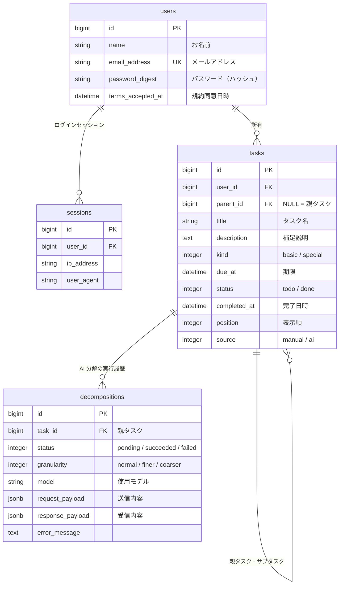

# データ設計

## ER 図

## テーブル定義

共通: すべてのテーブルに `created_at` / `updated_at`（datetime, NOT NULL）を持つ。

### users
| カラム | 型 | NULL | 既定値 | 説明 |
|---|---|---|---|---|
| id | bigint | NO | | PK |
| name | string | NO | | お名前（最大 50 文字） |
| email_address | string | NO | | メールアドレス。小文字に正規化。**ユニーク** |
| password_digest | string | NO | | `has_secure_password` |
| terms_accepted_at | datetime | NO | | 利用規約に同意した日時 |

### sessions
Rails 8 の認証ジェネレータの構成に従う。
| カラム | 型 | NULL | 説明 |
|---|---|---|---|
| id | bigint | NO | PK |
| user_id | bigint | NO | FK → users |
| ip_address | string | YES | |
| user_agent | string | YES | |

### tasks
親タスクとサブタスクを 1 テーブルで持つ（自己参照）。**階層は 1 段のみ**（サブタスクの下にサブタスクは作らない）。

| カラム | 型 | NULL | 既定値 | 説明 |
|---|---|---|---|---|
| id | bigint | NO | | PK |
| user_id | bigint | NO | | FK → users。親子で同じユーザーであること |
| parent_id | bigint | YES | | FK → tasks。NULL なら親タスク |
| title | string | NO | | タスク名（最大 200 文字） |
| description | text | YES | | 補足説明 |
| kind | integer | NO | 0 | `basic`（基本タスク：自分だけで進められる）/ `special`（特殊タスク：他者の確認・承認・返答待ちが発生する） |
| due_at | datetime | YES | | 期限。時刻まで持つ（「15 時までに依頼」に対応） |
| status | integer | NO | 0 | `todo` / `done`。親タスクは、すべてのサブタスクが完了すると自動で `done` になり、未完了のサブタスクが増えると `todo` に戻る |
| completed_at | datetime | YES | | 完了日時 |
| position | integer | NO | 0 | 親タスク内の表示順 |
| source | integer | NO | 0 | `manual`（手動追加）/ `ai`（AI 生成） |

インデックス: `(user_id, status, due_at)`、`parent_id`

### decompositions
AI 分解 1 回分の実行履歴。再分解・障害調査・品質評価に使う。

| カラム | 型 | NULL | 既定値 | 説明 |
|---|---|---|---|---|
| id | bigint | NO | | PK |
| task_id | bigint | NO | | FK → tasks（親タスク） |
| status | integer | NO | 0 | `pending` / `succeeded` / `failed` |
| granularity | integer | NO | 0 | `normal` / `finer`（もっと細かく）/ `coarser`（もっとざっくり） |
| model | string | YES | | 使用した AI モデル名 |
| request_payload | jsonb | NO | `{}` | AI に送った内容 |
| response_payload | jsonb | YES | | AI から受け取った内容 |
| error_message | text | YES | | 失敗時のエラー内容 |

## 主なクエリ

| 用途 | 条件 | 並び順 |
|---|---|---|
| マイタスク（S-5） | `user_id = 自分` かつ `parent_id IS NULL` かつ `status = todo`（完了済みを表示時は status 条件なし） | `due_at ASC NULLS LAST, id` |
| タスク詳細（S-4） | `parent_id = 親タスク` | `due_at ASC NULLS LAST, position, id` |
| 日付タブ | 上記に `due_at` の日付で絞り込み | 同上 |
