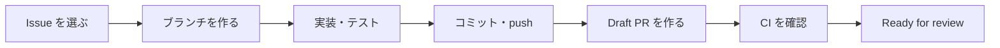

# 開発の進め方（最初の Pull Request まで）

[開発環境の構築](setup.md) が終わったら、この手順で 1 つの Issue を実装して Pull Request（PR）を出すところまで進めます。
ルールの詳細は [キックオフ資料](../kickoff.md) の (5)〜(8) にあります。

## 全体の流れ



## 1. 最初に読むもの

| 順番 | ドキュメント | 読む目的 |
|---|---|---|
| 1 | [キックオフ資料](../kickoff.md) | 目的・体制・開発ルール（ブランチ・テスト・コミュニケーション） |
| 2 | [要件定義](../requirements.md) | 誰のための何のアプリか、各機能の受入条件 |
| 3 | [画面設計](../screens.md) | 画面一覧と画面遷移、各画面の要素 |
| 4 | [データ設計](../data-model.md) | テーブルとカラム |
| 5 | [AI タスク分解の設計](../ai-decomposition.md) | AI 部分の仕組み（AI まわりを担当するとき） |

## 2. Issue を選ぶ

1. [カンバン（GitHub Projects）](https://github.com/users/hisaju/projects/8/views/2) を開く（リポジトリの **Issues** からも探せる）
2. **Ready** 列の Issue から担当を決め、Issue の右側 **Assignees** に自分を設定する
3. Issue 本文の **受入条件（チェックリスト）** を読み、何ができれば完了かを確認する
   - 分からないことは、着手前に Issue のコメントかチャンネルで質問する

## 3. ブランチを作る

ブランチは「作業用のコピー」です。`main` で直接作業はしません。

```bash
$ git switch main
$ git pull
```

Issue がエピック（大きな要件）の子 Issue かどうかで、ブランチを作る元が変わります。Issue 本文に「Epic #番号」と書かれていれば子 Issue です。

```bash
# エピックの子 Issue の場合: epic ブランチから作る
$ git fetch origin
$ git switch -c feature/<Issue番号>-<短い英語の説明> origin/epic/<エピック番号>-<説明>

# エピックではない小さな修正の場合: main から作る
$ git switch -c feature/<Issue番号>-<短い英語の説明>
```

例: `feature/42-task-list-sort`（バグ修正なら `fix/43-due-label-timezone`）

## 4. 実装する

- アプリは `docker compose up -d` で起動したまま、エディタでファイルを編集し、ブラウザを再読み込みして確認する
- テストを先に書いてから実装する（受入条件 → テスト → 実装）。書き方は既存の `spec/` 配下を参考にする
- 仕様と違う作りになったときは、同じ PR で `docs/` も直す

こまめにテストと書き方チェックを実行します。

```bash
$ docker compose run --rm web bundle exec rspec
$ docker compose run --rm web bin/rubocop -a
```

## 5. コミットして push する

```bash
$ git status                       # 変更したファイルを確認
$ git add <ファイル名>              # コミットに含めるファイルを選ぶ
$ git commit -m "feat: マイタスクを期限順に並べる"
$ git push -u origin HEAD          # GitHub に送る（2 回目以降は git push だけでよい）
```

コミットメッセージは `<種別>: <要約>` の形で書きます。

| 種別 | 使うとき |
|---|---|
| `feat` | 機能を追加した |
| `fix` | 不具合を直した |
| `refactor` | 動きを変えずにコードを整理した |
| `test` | テストだけを追加・修正した |
| `docs` | ドキュメントだけを変更した |
| `chore` | 設定・依存関係など、上のどれにも当たらない変更 |

## 6. Draft PR を作る

**最初は必ず Draft（下書き）で作ります。**

- GitHub の画面から: push 後に表示される **Compare & pull request** → 向き先（base）を選ぶ → **Create draft pull request**
- GitHub CLI から:

```bash
# エピックの子 Issue の場合（向き先は epic ブランチ）
$ gh pr create --draft --base epic/<エピック番号>-<説明>
# エピックではない場合（向き先は main）
$ gh pr create --draft --base main
```

PR の本文はテンプレートが自動で入ります。

- **概要**: 何を・なぜ変えたか
- `Closes #<Issue番号>` を必ず書く
- **確認方法**: 実行したコマンドと確認した画面
- 画面を変えたときは**スクリーンショット**を貼る

## 7. CI を確認して Ready for review にする

PR を作ると、GitHub Actions（CI）が自動でテスト・書き方チェック・セキュリティ診断を実行します。

1. PR の下部にあるチェックがすべて緑（✓）になるのを待つ
   - 赤（×）になったら **Details** を開いてエラーを確認し、手元で直して push し直す
2. セルフチェック（受入条件をすべて満たしているか、不要なファイルが入っていないか）をする
3. **Ready for review** を押す

マージの条件は向き先によって違います。

| 向き先 | マージの条件 |
|---|---|
| epic ブランチ（子 Issue） | CI がすべて緑 |
| `main` | CI がすべて緑 ＋ レビュー承認 1 名 |

## 8. マージされたら

```bash
$ git switch main
$ git pull
$ git branch -d feature/<Issue番号>-<説明>   # 手元の作業ブランチを消す
```

カンバンのカードが Done に移っていることを確認して、次の Issue に進みます。

## 困ったとき

- 30 分調べても進まなければ、Mattermost の「Bチーム NCT × RUNTEQハッカソン」チャンネルで質問する（テンプレートは [キックオフ資料 (9)](../kickoff.md#9-コミュニケーションルール)）
- 環境のトラブルは [開発環境の構築 — うまくいかないとき](setup.md#7-うまくいかないとき)
- Git の操作で迷ったら、何かを消したり上書きしたりする前に相談する（`git reset --hard` や `git push --force` は使わない）
