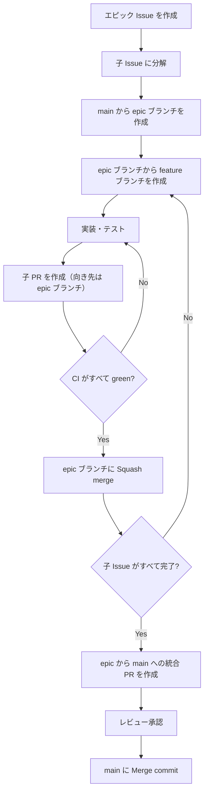

# キックオフ資料 — Tasklet（AI タスク分解アプリ）

## (1) プロダクトの目的とゴール

### 解決したい課題
経験の浅い社員は「見積もり作成」「起案書作成」のような**大分類のタスクをそのまま ToDo に登録**し、空いた時間に着手する。
その結果、他者の返答待ち・承認待ちなどの工程に直前で気づき、期限ぎりぎりの対応や残業につながっている。
ベテラン社員は同じタスクを、着手できる手順に分解し、期限から逆算して進めている。

### プロダクトのゴール
大分類タスクを入力するだけで、AI がベテランのように**実行可能な粒度のサブタスク**へ分解し、期限から逆算した計画を立てられるようにする。

### 成功の条件
| 観点 | 条件 |
|---|---|
| 体験 | 親タスクを入力してから 30 秒以内に、3〜8 件のサブタスクが表示される |
| 品質 | ペルソナの 3 事例（見積・起案書・経費申請）で、ベテランの分解に含まれる工程を網羅できる（AI 評価セットに合格） |
| 運用 | サブタスクの追加・期限設定・完了を、分解後の画面だけで完結できる |

### MVP の範囲
| 区分 | 内容 |
|---|---|
| MVP | 会員登録／ログイン、タスクの入力、AI による分解、タスクの手動追加、期限の個別設定、完了タスクの非表示化、期限順の一覧表示 |
| 拡張（時間があれば） | 分解の調整（再分解・もっと細かく・もっとざっくり）、親タスクの進捗率表示 |
| 対象外 | チーム共有、通知（メール・Mattermost）、カレンダー連携、モバイルアプリ |

## (2) チームの役割と責任範囲

| 役割 | 責任範囲 | 主に見るもの | 判断すること |
|---|---|---|---|
| プロダクトマネージャー（PdM） | 要件定義・優先順位・受入判断 | `docs/requirements.md`、カンバンの Backlog / Ready、デモ | 何を作るか・作らないか、機能の受入 OK/NG |
| プロジェクトマネージャー（PjM） | スケジュール・進捗・リスク管理 | カンバン全体、マイルストーン | スコープ調整の提案、停滞時のエスカレーション |
| テックリード（TL） | 設計・技術選定・コード品質・AI 設計 | PR、`docs/data-model.md`、`docs/ai-decomposition.md` | 設計方針、PR の最終承認、技術的な優先度 |
| エンジニアメンバー | 実装・テスト・PR 作成・レビュー | 担当 Issue、PR | 実装方法（設計方針の範囲内） |

### 相談先
| 困りごと | 相談先 |
|---|---|
| 仕様が曖昧／要件の解釈に迷う | PdM |
| 期限に間に合わない／作業が重なっている | PjM |
| 設計・実装方針・技術的に詰まった | TL |
| 環境構築・ツールの使い方 | エンジニアメンバー同士 → 解決しなければ TL |

## (3) スケジュールとマイルストーン

期間: **2026-10-26（月）〜 2026-11-06（金）の 2 週間（10 営業日）**

| 日程 | マイルストーン | 内容 | 完了の目安 |
|---|---|---|---|
| D1–D2（10/26–10/27） | M1 設計確定 | 仕様書レビュー、画面モック確定、ER 確定、Issue 起票 | Ready 列に MVP の Issue が揃う |
| D3–D5（10/28–10/30） | M2 基盤実装 | 認証、タスク CRUD、期限順一覧、完了・非表示 | AI なしでタスク管理ができる |
| D6–D7（11/2–11/3） | M3 AI 分解 | AI 分解（非同期）、手動追加、期限設定 | 主要導線が通る |
| D8（11/4） | **中間デモ** | PdM 受入、残課題の優先度付け | MVP の受入 OK |
| D9（11/5） | M4 拡張・品質 | 分解の調整、進捗率、AI 評価セットでのチューニング | 評価セット合格 |
| D10（11/6） | **最終デモ** | リリース判断、振り返り | — |

### 定例
特に定めない。打ち合わせが必要になったら、その都度 Discord で行う（(9) 参照）。中間デモ・最終デモの日程は上のマイルストーンのとおり。

## (4) 技術スタックと開発環境

| 区分 | 採用技術 |
|---|---|
| 言語 / FW | Ruby 3.4 / Rails 8.1 |
| フロント | Hotwire（Turbo・Stimulus）、Tailwind CSS v4、importmap |
| DB | PostgreSQL 17 |
| 非同期処理 | Active Job（本番は Solid Queue） |
| AI | OpenAI API（Responses API ＋ Structured Outputs） |
| テスト | RSpec、FactoryBot、Capybara ＋ Cuprite、WebMock、SimpleCov |
| 品質 | RuboCop（rubocop-rails-omakase ＋ rubocop-rspec）、Brakeman、bundler-audit |
| 環境 | Docker Compose（web / db / css） |

セットアップ手順はリポジトリ直下の [README.md](../README.md) を参照。

## (5) 命名規則・Lint・コードスタイル

- **Rails 標準の命名**に従う（モデルは単数形 `Task`、テーブル・コントローラは複数形 `tasks` / `TasksController`、ファイルはスネークケース）
- 機能単位の処理はモデルに寄せ、外部 API 呼び出しなど複数モデルにまたがる処理は `app/services/` に置く
- コントローラは REST の 7 アクションに収める。それ以外の操作はリソースを切り出す（例：完了 → `Tasks::CompletionsController#create`）
- Lint は RuboCop（`.rubocop.yml`）。**CI で違反があればマージしない**
- RSpec の `describe` / `it` は日本語で書いてよい
- コミットメッセージ: `<種別>: <要約>`（種別: `feat` / `fix` / `refactor` / `test` / `docs` / `chore`）。本文は日本語可

## (6) 開発フロー（GitHub Flow ＋ エピックブランチ）

大きな要件はエピックとして扱い、子 Issue に分解して進める。



| ブランチ | 作成元 | 命名 |
|---|---|---|
| `main` | — | 常設。常にデプロイ可能な状態を保つ |
| epic ブランチ | `main` | `epic/<エピックの Issue 番号>-<短い説明>` |
| feature ブランチ | epic ブランチ | `feature/<子 Issue 番号>-<短い説明>`（バグ修正は `fix/…`） |

| マージ | 条件 | 方法 |
|---|---|---|
| 子 PR → epic ブランチ | CI がすべて green（レビューは不要） | Squash merge |
| epic ブランチ → `main` | CI がすべて green ＋ レビュー承認 1 名（設計に関わる変更は TL の承認必須） | Merge commit |

- PR は **Draft で作成** し、CI が通ってセルフチェックが済んだら Ready for review にする
- 子 PR の本文に `Closes #<子 Issue 番号>` を書く。ただし向き先が `main` ではないため、この時点では Issue は閉じない。epic → `main` の統合 PR の本文に、エピックと全子 Issue の `Closes` を並べ、`main` へのマージ時にまとめて閉じる
- 小さな修正でエピックにする必要がないものは、`main` から feature ブランチを切り、`main` 向けの PR を作る（CI green ＋ レビュー承認 1 名で Squash merge）

## (7) テストコード方針

| 種類 | 置き場所 | 何を書くか | 優先度 |
|---|---|---|---|
| Model spec | `spec/models` | バリデーション・スコープ・状態遷移 | ◎ 最初に書く |
| Service spec | `spec/services` | AI 分解（LLM はスタブ）、期限の丸め | ◎ |
| Request spec | `spec/requests` | 認可（他人のタスクに触れない）、ステータスコード | ○ |
| System spec | `spec/system` | 主要導線のみ（登録 → 分解 → 完了） | △ 最小限 |

- 受入条件をテストケースに落としてから実装する（Red → Green → Refactor）
- **外部通信は WebMock で全遮断**。AI 分解はテスト用のスタブクライアントで検証し、実 API は AI 評価セットでのみ使う
- CI（GitHub Actions）で RuboCop・Brakeman・RSpec を実行。すべて green でないとマージしない
- カバレッジ: 行カバレッジ **80%** を目標とするが、あくまで参考値として扱う。数値を上げるためだけのテストは書かず、カバレッジ不足でマージを止めることもしない（CI での閾値チェックは行わない）

## (8) タスク管理と運用ルール

### カンバン（GitHub Projects）
| 列 | 意味 | 入れる人 |
|---|---|---|
| Backlog | アイデア・未整理 | 誰でも |
| Ready | 受入条件が書かれ、着手できる | PdM（優先度順に並べる） |
| In Progress | 作業中 | 担当者 |
| Review | PR レビュー待ち | 担当者 |
| Done | マージ済み | 自動 |

- WIP 制限: **In Progress は 1 人 2 枚まで**
- Issue には受入条件（チェックリスト）を必ず書く（`.github/ISSUE_TEMPLATE` を使う）
- 見積もりは半日以内に収まる粒度に分割する

### 停滞したときのルール
| 状況 | アクション |
|---|---|
| 30 分調べても解決しない | チャンネルで質問する（下記テンプレート） |
| カードが 2 日動かない | チャンネルで状況を共有する。PjM が分割・担当変更を提案 |
| PR がレビュー待ちのまま半日経過 | レビュアーにメンション。当日中にレビューする |
| マイルストーンに間に合わない見込み | 判明した時点で PjM に連絡 → PdM とスコープ調整 |

## (9) コミュニケーションルール

### チャンネル
連絡・相談・質問・共有は、すべて **Mattermost の「Bチーム NCT × RUNTEQハッカソン」チャンネル**で行う。

### 質問のしかた
- 個別 DM ではなく**チャンネルで質問**する（他の人の学びになる）
- 返信はスレッドで行う
- 以下のテンプレートで書く

```
【やりたいこと】
【起きていること】（エラーメッセージはコードブロックで）
【試したこと】
【仮説】
【関連 Issue / PR】
```

### ミーティング
定例は設けない。打ち合わせが必要になったら、チャンネルで声をかけて **Discord** で行う。
