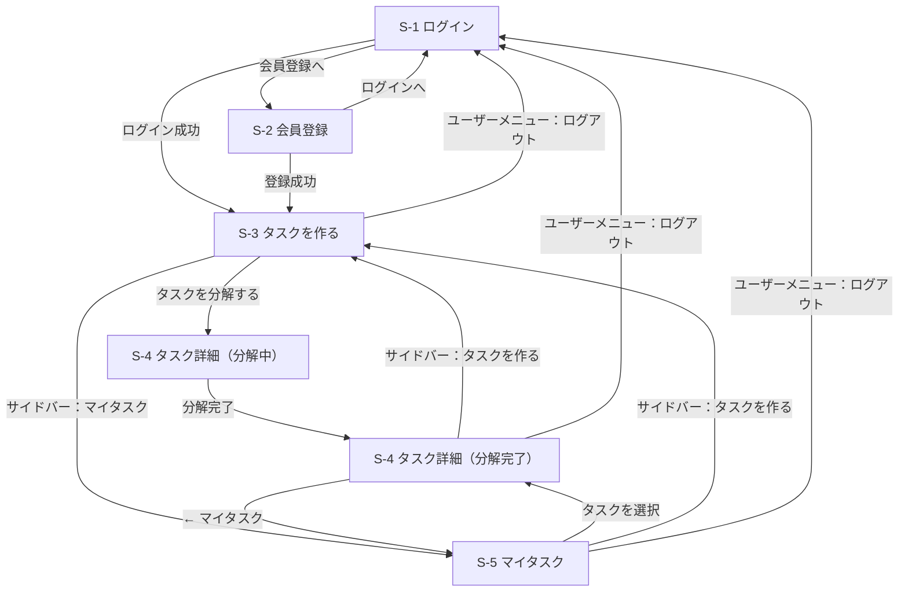

# 画面設計

デザインは Figma モック（Tasklet）に準拠する。現在のアプリは固定データで画面を再現した**画面モック**。

## 画面一覧

| ID | 画面名 | URL（実装予定） | モック URL | ログイン | 対応 UC |
|---|---|---|---|---|---|
| S-1 | ログイン | `/session/new` | `/login` | 不要 | UC-7 |
| S-2 | 会員登録 | `/registration/new` | `/signup` | 不要 | UC-7 |
| S-3 | タスクを作る（ホーム） | `/` | `/` | 必要 | UC-1 |
| S-4 | タスク詳細（分解結果） | `/tasks/:id` | `/tasks/sample` | 必要 | UC-2〜5, 8, 9 |
| S-5 | マイタスク（親タスク一覧） | `/tasks` | `/tasks` | 必要 | UC-5, 6, 9 |

## 画面遷移図

分解したタスクは S-5 マイタスクに期限の近い順で並ぶ。分解中の S-4 は分解が終わると自動で分解完了の表示に切り替わり、ブラウザの「戻る」で分解中の表示には戻らない。

## 共通レイアウト

- **ログイン後の画面（S-3〜S-5）**: 左にサイドバー（幅 232px）
  - ロゴ「Tasklet」
  - ナビゲーション：タスクを作る／マイタスク（現在の画面をハイライト）
  - 下部にユーザー情報（アバター・名前・メールアドレス）とユーザーメニュー「…」。メニューは上向きに開き、項目は「ログアウト」（S-1 へ遷移）。メールアドレスが長いときは末尾を省略する
- **ログイン前の画面（S-1, S-2）**: サイドバーなし。中央にロゴとフォームのカード。画面下部に「© Tasklet」を置く（ログイン前の画面だけの意図的な表示）
- **ヘッダーバー**（高さ 68px、メイン領域の全幅）は S-4・S-5 にだけ置く。S-3 は入力に集中させるためヘッダーバーを置かない
  - 左には現在地（S-5「マイタスク」）または戻り先（S-4「← マイタスク」）を 1 つだけ置く。パンくずは使わない
  - 右に「完了済みを表示」ボタンを置く。初期状態では完了済みのサブタスク・親タスクを隠し、押すと表示して表記が「完了済みを隠す」に変わる。もう一度押すと隠す
- **メニュー「…」**: 押すと項目の一覧が開き、項目の外側をクリックするか Esc キーで閉じる。開いたときは最初の項目にフォーカスが移る。「削除」は赤字で表示する
- **分解ステータス**: 分解中（橙・点滅する点）／分解完了（緑）／分解失敗（赤）。S-4 と S-5 で同じ大きさ・色で表示する
- **対象は PC 幅のみ**。サイドバーは 232px 固定で、狭い幅（モバイル／タブレット）への対応は行わない
- **キーボード操作**: リンク・ボタンはフォーカス時に緑のリング（`ring-brand-dot`。白地・背景色の上でもコントラスト 3:1 以上）を表示する。サイドバーの現在地は `aria-current` で支援技術にも伝える

### 見出しの型

| 型 | 対象 | 構成 |
|---|---|---|
| 認証 | S-1, S-2 | 英字の小見出し（eyebrow）→ 見出し 32px → 説明文 13px |
| ホーム | S-3 | アイコン → eyebrow → 見出し 44px → 説明文 14px |
| 一覧・詳細 | S-4, S-5 | eyebrow の位置に分解ステータス（S-4）または「MY TASKS」（S-5）→ 見出し 40px（行間 1.45）→ 説明文 11px |

見出しはすべてセリフ体・太字。eyebrow は 11px・字間広め・緑。

### 文字サイズ

| サイズ | 主な用途 |
|---|---|
| 10px | 補足説明、種別バッジ・ステータス・期限、進捗、小さいボタン、入力例チップ |
| 11px | eyebrow、ラベル、説明文、日付見出し、日付タブ |
| 13px | サイドバーのナビゲーション、ヘッダーの画面名、サブタスク名、主要ボタン |
| 15px | S-3 の入力欄 |
| 17px | S-5 の親タスク名 |
| 32px | S-1・S-2 の見出し |
| 40px | S-4・S-5 の見出し |
| 44px | S-3 の見出し |

このほか、ロゴ（18px／20px）、サイドバーのユーザー名（12px）、フォームの入力欄と S-3 の説明文（14px）、認証画面下部のリンク文（12px）がある。10px より小さい文字は使わない。

### 期限の表記

期限は日時で持ち、S-4・S-5 とも同じ書式で表示する。

| 期限 | 表示 |
|---|---|
| 今日 | 今日 17:00 |
| 明日 | 明日 12:00 |
| それ以外 | 11/1 17:00（M/D HH:MM） |
| 未設定 | 期限なし |

S-4 の日付タブ（今日／明日／M/D）と S-5 の日付見出し（今日／明日／M/D／期限なし）は日付部分だけを表示する。

## 各画面の要素

### S-1 ログイン
| 要素 | 内容 |
|---|---|
| 見出し | WELCOME BACK ／ おかえりなさい |
| 入力 | メールアドレス、パスワード |
| リンク | パスワードをお忘れですか？、会員登録 |
| チェック | ログイン状態を保持する |
| ボタン | ログイン |

### S-2 会員登録
| 要素 | 内容 |
|---|---|
| 見出し | CREATE ACCOUNT ／ はじめましょう |
| 入力 | お名前、メールアドレス、パスワード（8 文字以上）、パスワード（確認） |
| チェック | 利用規約とプライバシーポリシーに同意する（必須） |
| ボタン | アカウントを作成する |
| リンク | ログイン |

### S-3 タスクを作る
| 要素 | 内容 |
|---|---|
| 見出し | AI TASK ASSISTANT ／ 今日は何に取り組みますか？ |
| 入力 | 自由文（プレースホルダ：例：来週の経営会議に向けて、新規事業の提案資料を作りたい） |
| 操作 | タスクを分解する（⌘ + Enter でも送信） |
| 入力例チップ | イベントの企画を進める／資格試験の学習計画を立てる／引っ越しの準備をする |

### S-4 タスク詳細
| 要素 | 内容 |
|---|---|
| ヘッダー | ← マイタスク（S-5 へ戻る）、完了済みを表示／隠す |
| ステータス | 分解中／分解完了／分解失敗（見出しの上） |
| 見出し | 親タスク名、説明文（ステータスごとに下表）、親タスクのメニュー（編集・再分解・削除。いずれも見た目のみ） |
| 親タスクの期限・進捗 | 見出しの下に期限（時刻付き。未設定は「期限なし」）と進捗（「n/m 完了」とプログレスバー。サブタスクが無いときは「—」）。進捗はサブタスクの完了チェックに合わせてその場で変わる |
| 日付タブ | すべて／今日／明日／サブタスクの期限に含まれる日付（M/D）。期限なしのサブタスクは「すべて」にだけ表示 |
| サブタスクカード | 完了チェック、種別バッジ（基本タスク／特殊タスク）、期限（時刻付き。例：今日 17:00／期限なし）、タスク名、補足説明、番号、メニュー（編集・期限設定・削除。いずれも見た目のみ） |
| 種別バッジ | 基本タスク＝自分だけで進められる手順／特殊タスク＝他者の確認・承認・返答待ちが発生する手順（早めに着手する）。バッジにマウスを重ねると説明が出る |
| 完了チェック | 押すと完了になり、「完了済みを表示」していなければ一覧から消える。表示中は塗りつぶしたチェックと打ち消し線で示し、もう一度押すと未完了に戻る。番号は完了状態に関わらず最初の順のまま |
| すべて完了したとき | 一覧の代わりに「すべての手順が完了しました」、「完了済みを表示」で確認できる旨の案内、「マイタスクへ」（S-5 へ） |
| 追加 | タスクを追加（一覧の末尾にカードを追加する。分解中・分解失敗のときも使える） |

ステータスごとの表示:

| ステータス | 説明文 | 一覧 |
|---|---|---|
| 分解中 | AI が実行しやすい手順に分解しています。通常 30 秒以内に完了します。 | 日付タブと一覧の代わりに読み込み中のカード 3 枚。分解が終わると自動で分解完了の表示に切り替わる。進捗は「—」 |
| 分解完了 | AIが実行しやすいステップに分解しました。内容は自由に編集できます。 | 日付タブとサブタスクカード |
| 分解失敗 | 分解に失敗しました。再度お試しください | 「再分解する」ボタン（見た目のみ）。一覧は空で、進捗は「—」 |

親タスクは手動で完了にしない。サブタスクがすべて完了すると親タスクも完了（S-5 で完了済みとして扱う）になり、未完了のサブタスクを追加すると未完了に戻る。

### S-5 マイタスク
| 要素 | 内容 |
|---|---|
| ヘッダー | 現在地「マイタスク」（リンクなし）、完了済みを表示／隠す |
| 一覧 | 親タスク（大カテゴリ）を、日付ごとの見出し（今日・明日・M/D・期限なし）の下に期限の近い順で表示 |
| 各行（カード） | 親タスク名、期限（時刻付き。例：明日 12:00／期限なし）、分解ステータス（分解中／分解完了／分解失敗）、進捗（例：2/5 完了とプログレスバー。サブタスクが無いときは「—」） |
| 行の操作 | クリックでタスク詳細（S-4）へ、メニュー（編集・削除） |
| 空のとき | 「まだタスクがありません」と「タスクを作る」への導線 |
