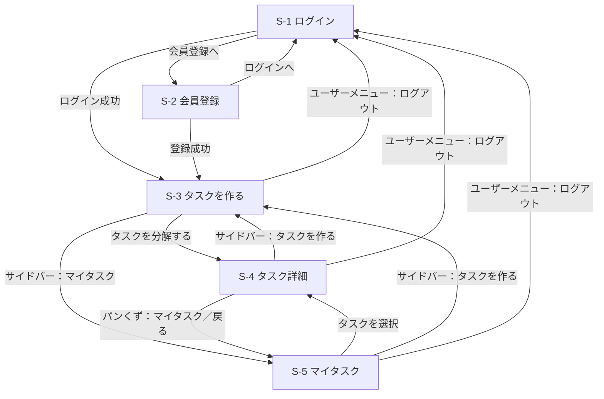

# 画面設計

デザインは Figma モック（Tasklet）に準拠する。現在のアプリは固定データで画面を再現した**画面モック**。

## 画面一覧

| ID | 画面名 | URL（実装予定） | モック URL | ログイン | 対応 UC |
|---|---|---|---|---|---|
| S-1 | ログイン | `/session/new` | `/login` | 不要 | UC-7 |
| S-2 | 会員登録 | `/registration/new` | `/signup` | 不要 | UC-7 |
| S-3 | タスクを作る（ホーム） | `/` | `/` | 必要 | UC-1 |
| S-4 | タスク詳細（分解結果） | `/tasks/:id` | `/tasks/sample` | 必要 | UC-2〜5, 8, 9 |
| S-5 | マイタスク（親タスク一覧） | `/tasks` | `/tasks` | 必要 | UC-5, 6, 9 |

## 画面遷移図

## 共通レイアウト

- **ログイン後の画面（S-3〜S-5）**: 左にサイドバー（幅 232px）
  - ロゴ「Tasklet」
  - ナビゲーション：タスクを作る／マイタスク（現在の画面をハイライト）
  - 下部にユーザー情報（アバター・名前・プラン）とメニュー（ログアウト）
- **ログイン前の画面（S-1, S-2）**: サイドバーなし。中央にロゴとフォームのカード

## 各画面の要素

### S-1 ログイン
| 要素 | 内容 |
|---|---|
| 見出し | WELCOME BACK ／ おかえりなさい |
| 入力 | メールアドレス、パスワード |
| リンク | パスワードをお忘れですか？、会員登録 |
| チェック | ログイン状態を保持する |
| ボタン | ログイン |

### S-2 会員登録
| 要素 | 内容 |
|---|---|
| 見出し | CREATE ACCOUNT ／ はじめましょう |
| 入力 | お名前、メールアドレス、パスワード（8 文字以上）、パスワード（確認） |
| チェック | 利用規約とプライバシーポリシーに同意する（必須） |
| ボタン | アカウントを作成する |
| リンク | ログイン |

### S-3 タスクを作る
| 要素 | 内容 |
|---|---|
| 見出し | AI TASK ASSISTANT ／ 今日は何に取り組みますか？ |
| 入力 | 自由文（プレースホルダ：例：来週の経営会議に向けて、新規事業の提案資料を作りたい） |
| 操作 | タスクを分解する（⌘ + Enter でも送信） |
| 入力例チップ | イベントの企画を進める／資格試験の学習計画を立てる／引っ越しの準備をする |

### S-4 タスク詳細
| 要素 | 内容 |
|---|---|
| ヘッダー | 戻る、パンくず（マイタスク / タスク詳細）、完了済みを表示 |
| ステータス | 分解中／分解完了／分解失敗 |
| 見出し | 親タスク名、説明文、親タスクのメニュー（編集・再分解・削除） |
| 日付タブ | すべて／今日／明日／サブタスクに含まれる日付（M/D） |
| サブタスクカード | 完了チェック、種別バッジ（基本タスク／特殊タスク）、期限、タスク名、補足説明、番号、メニュー（編集・期限設定・削除） |
| 追加 | タスクを追加 |

### S-5 マイタスク
| 要素 | 内容 |
|---|---|
| ヘッダー | タイトル「マイタスク」、完了済みを表示 |
| 一覧 | 親タスク（大カテゴリ）を、日付ごとの見出し（今日・明日・M/D・期限なし）の下に期限の近い順で表示 |
| 各行（カード） | 親タスク名、期限、分解ステータス（分解中／分解完了／分解失敗）、進捗（例：2/5 完了とプログレスバー） |
| 行の操作 | クリックでタスク詳細（S-4）へ、メニュー（編集・削除） |
| 空のとき | 「まだタスクがありません」と「タスクを作る」への導線 |
